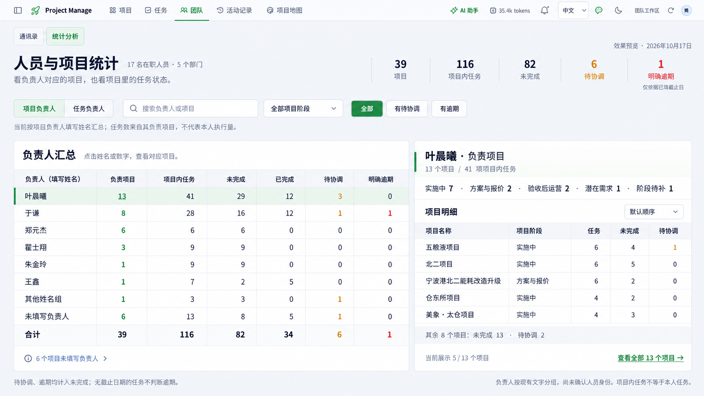

# 人员与项目统计：选定方案深化

2026-10-17。状态：效果图与功能建议，尚未实现。以用户选定的“人员汇总表”效果图为基础；只做人员和项目统计分析，不包含日报处理、生成任务、排班或人员绩效。

本轮为选定方向的单版深化；生成方式及完整提示词见 [生成说明](refinement-prompt.json)。

筛选、自动排序、偏好记忆与分批交付详见 [表格交互与开发计划](../../people-project-statistics-development-plan.md)。

## 主要不足

原图分别显示项目负责人分布和任务责任分布，两个统计集合没有直接关联，用户必须自己理解它们的区别。项目数只说明数量，不能解释项目处于哪个阶段、哪些项目有未完成或待协调事项；“查看项目”也没有展示下钻后的体验。顶部人数/部门数和底部部门人数重复占用空间。

“占全部项目”的条形还容易误读为排名或进度。若保留必须按总项目数作分母，例如 13/39 为 33.3%；本版直接去除比例条，优先展示可追溯的任务状态。

## 推荐改法

| 调整 | 页面表现 | 分析价值 |
| --- | --- | --- |
| 明确统计视角 | “项目负责人 / 任务负责人”切换 | 区分负责项目与直接执行任务，避免错归工作量 |
| 一张主汇总表 | 负责人、负责项目、项目内任务、未完成、已完成、待协调、明确逾期 | 从项目数量进一步看到其负责项目的事项状态 |
| 选中后联动明细 | 右侧显示该负责人名下项目、阶段及任务状态 | 每个数字能追溯到具体项目，保留比较上下文 |
| 有限筛选与排序 | 搜索负责人/项目、项目阶段、有待协调、有逾期；排序只使用已知事实 | 快速找到需要关注的项目，不增加处理工作流 |
| 缩减静态信息 | 人数/部门数缩成标题旁背景；移除底部重复人数与比例条 | 首屏空间用于真实关联与明细 |

## 核心口径

- 主视角按项目 `owner` 的现有文字分组，聚合这些项目的有效末级任务；不表示该负责人本人执行的任务，也不按同名推断账号或通讯录身份。
- 另一视角按任务 `assignee`/现有身份规则统计，不能把两类数字拼接成同一种个人工作量。
- 未完成＝待办＋进行中＋待协调；待协调和明确逾期都是未完成子集，不能重复相加。
- 明确逾期仅依据已填写的截止日期。当前116项任务中仅6项有截止日期；0逾期不能读作“无期限风险”。
- 任务已完成数是当前状态，不是本周新增完成量；任务完成占比不代表项目工程进度。
- 缺少任务记录与任务全部完成分别显示。未知或未关联不标为“空闲”。
- 人员、项目与下钻明细必须使用同一范围；点击某个状态数字时，明细显示该状态对应的具体事项。
- 部门人数可作组织背景；在负责人身份未确认前，不按姓名把项目自动归入部门。
- “项目阶段”筛选同步影响主表与明细；日期筛选需先明确筛的是工作安排、截止日期还是活动发生时间，本版不添加含义模糊的时间趋势。

## 本次只读核对的数据

数据日为2026-10-17，工作区revision156。本次查询再次核对了下列聚合；是设计依据，不是页面中应写死的常量。

| 项目负责人文字 | 项目 | 项目内任务 | 未完成 | 已完成 | 待协调 | 明确逾期 |
| --- | ---: | ---: | ---: | ---: | ---: | ---: |
| 叶晨曦 | 13 | 41 | 29 | 12 | 3 | 0 |
| 于谦 | 8 | 28 | 16 | 12 | 1 | 1 |
| 郑元杰 | 6 | 6 | 6 | 0 | 0 | 0 |
| 瞿士翔 | 3 | 9 | 9 | 0 | 0 | 0 |
| 朱金玲 | 1 | 9 | 9 | 0 | 0 | 0 |
| 王鑫 | 1 | 7 | 2 | 5 | 0 | 0 |
| 其他姓名组 | 1 | 3 | 3 | 0 | 1 | 0 |
| 未填写负责人 | 6 | 13 | 8 | 5 | 1 | 0 |
| 合计 | 39 | 116 | 82 | 34 | 6 | 1 |

选中“叶晨曦”展示13个项目，其中实施中7、方案与报价2、验收后运营2、潜在需求1、阶段待补1。效果图仅展示其中5项，须注明5/13并提供完整明细入口，不将部分列表冒充全部。

## 实现边界

沿用现有任务口径与详情入口，新增只读聚合和筛选联动即可；这次不要求身份模型迁移，不创建账号，不写入业务记录。初版优先完成主表、视角切换、联动明细和准确空态。趋势、利用率、自动结论不在本版范围。

效果图通过内置图片生成工具制作，属于视觉方案。实施时应重新校验数据与统计范围，并由真实数据驱动表格、颜色和任何图表比例。
