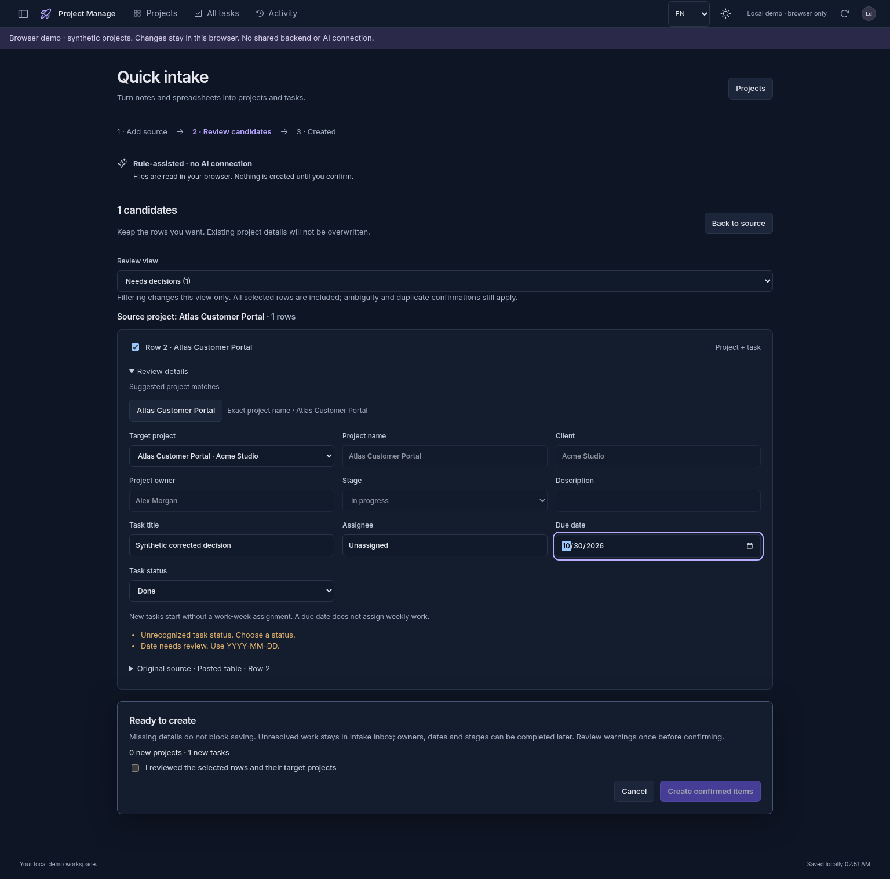
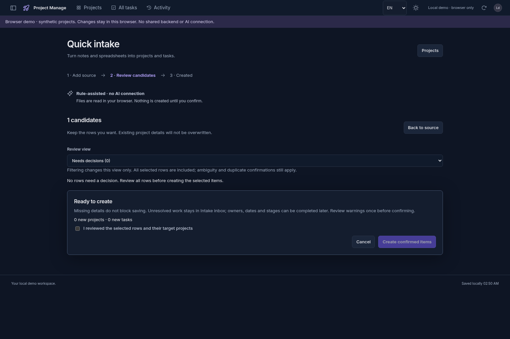
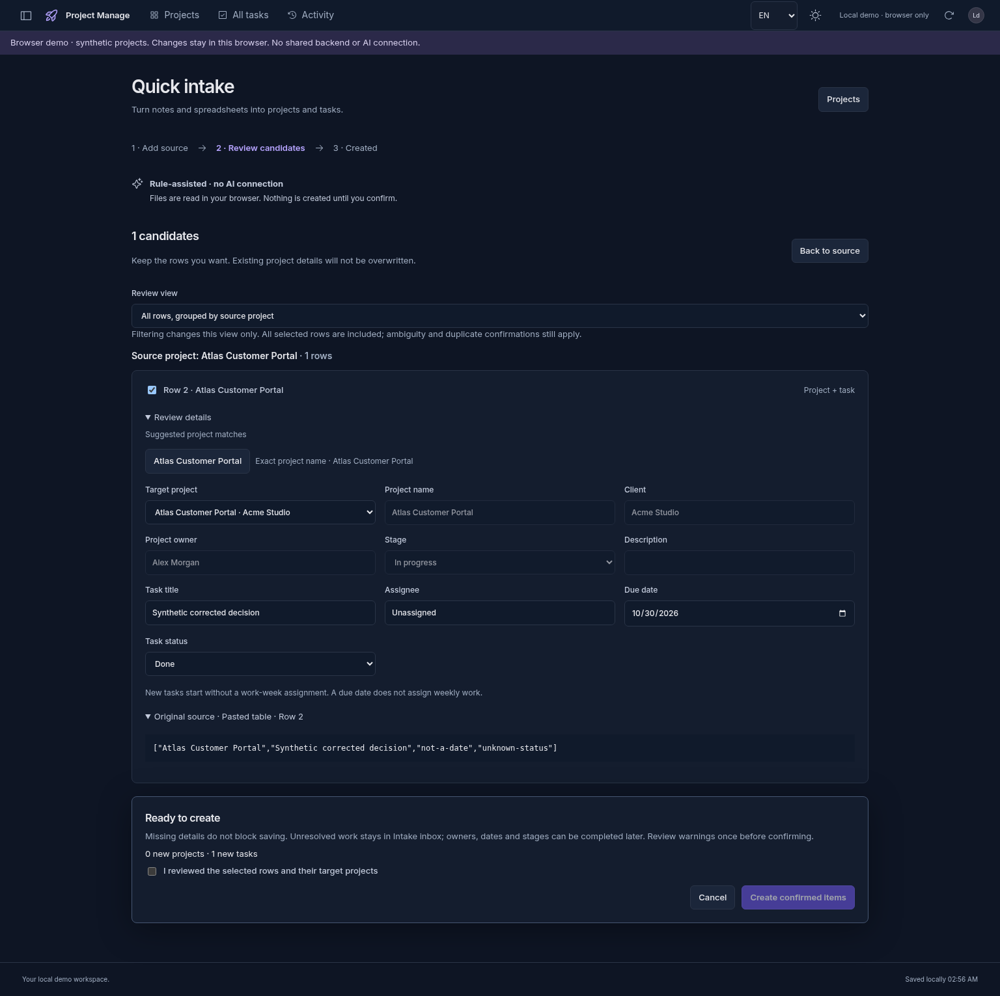
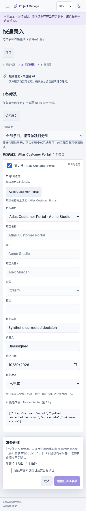
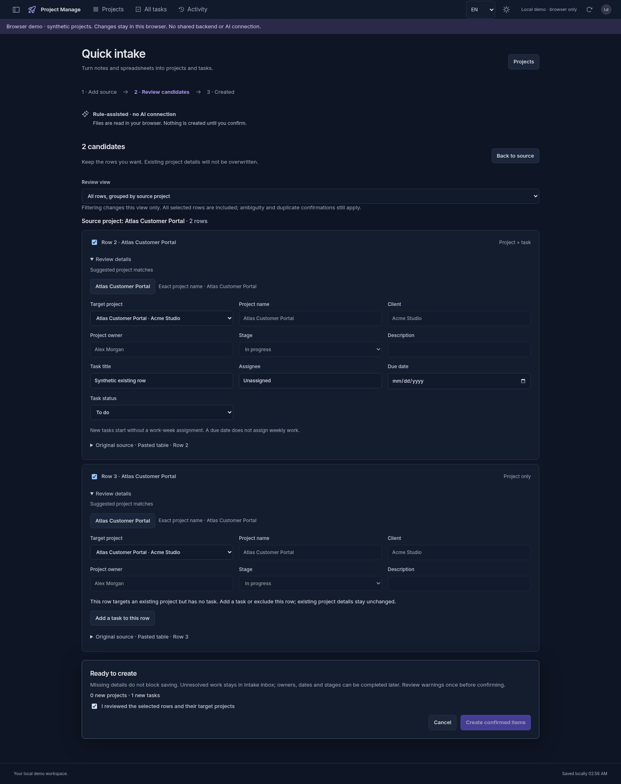

# M2：审阅只保留仍需处理的问题（2026-10-26）

本批基于 `70e91a7297a5780adbbfd88f6177eeb01cce2744`，继续原工作分支和 draft PR #1。已读取体验计划、收口表及现有映射、关注、草稿实现；没有重复建设这些功能。只使用合成内容，未接入真实 AI、Workbuddy/Codex API、付费服务或共享托管后端。

## 先验证，再改动

| 审计场景 | 基线结果 | 本批处理 |
| --- | --- | --- |
| 明确现有项目的十行 CSV，仅项目与任务两列 | 一次映射页、一次最终审阅、一次全批确认即可创建十个任务；无需逐行确认或填写客户、责任人、日期 | 原流程符合目标；增加回归证据，不制造新功能 |
| 原日期/状态不可识别，审阅中已改为有效日期和“完成” | 浏览器仍显示两条旧警告，待决定计数仍为 1 | 在用户提交对应字段选择时消除该字段提示，不改原文、不解除其他歧义或重复确认 |
| 输入仅含现有项目名称，没有新任务 | “待决定 0”隐藏该行，保存才会遇到“现有项目需要新任务”错误 | 该行保留在待决定列表，先解释原因，可直接补充任务或取消选中；未补前禁止提交无任务的行 |

补充任务后，焦点进入空任务标题；非首行详情也保持展开。待决定视图在输入期间保留正在编辑的行，离开该行后再按最新结果隐藏，避免输入首字后控件消失。缺少客户、责任人或日期仍可保存；已有项目资料不会因补任务而覆盖。

部署前的编译产物验收进一步复现两处交互时序问题：补任务后通用回退抢走新输入框焦点；输入已解决的行后直接点击取消，行收起移动按钮，使第一次点击丢失。焦点回退现只在焦点确实落到页面 body 时执行；指针操作等待 pointerup 和 click 完成后再收起已解决行，键盘离开仍正常更新。新增全部/待决定视图和桌面/390px 首次取消点击回归，未用增加重试或重复点击掩盖问题。

字段提示只在明确的 `change` 操作后消除，日期仍经过有效日期检查；不根据部分键入或未知日期猜测结果。源文本、原表格单元格、行号和项目匹配依据保持原样。恢复草稿保留修正后的字段和提示状态，但全批、歧义和重复写入确认仍须重新作出。其他原文冲突提示仍保留。

## 验证记录

- 基线：十行表格用例通过；缺任务用例实际得到 0 行而预期 1 行。日期/状态用例首次因测试使用不合适的标签选择器超时，改为可访问 combobox 角色后重新运行，实际得到 1 行而预期 0 行，确认产品缺陷。
- 首次修复后 3/3 针对性浏览器用例通过。扩展后 14/14 通过：本批 10 项加原映射/歧义 4 项；8 种中英 × 深浅色 × 1536/390px 组合覆盖字段修正、原文、恢复、重新确认、保存、刷新、撤销、axe 和横向溢出；补任务覆盖逐字输入、详情展开、离开取消、路由返回和再次恢复。
- 本批 5 项单元测试与原映射 3 项共 8/8 通过，验证字段提示的选择性处理、无效日期、缺字段、歧义/重复保护、原文及草稿确认重置。
- 环境重新启动后仅有干净骨架分支；取回原工作分支后精确 HEAD 与远端 PR 一致。工作区与仓库没有适用的 `AGENTS.md` 或 `.agents/skills`。依赖安装首次因默认 npm 缓存目录不可写失败，改用 `/tmp/pm-npm-cache` 后 `npm ci` 成功，锁文件未变。

焦点修正前的完整本地验收：**326/326 单元/API（33 文件）、116/116 Chromium E2E（8.0 分钟）**，lint、格式、Vue/API 类型检查和前后端编译全部通过。编译产物 smoke 验证入口资源、认证、浏览器 Demo 隔离/持久化、进程重启、独立会话与一致性备份恢复，意外浏览器错误 0；代理回放验证实际 Referer、安全会话、CSRF 保存/刷新，意外错误 0。没有启用测试重试或放宽断言、认证和限流。

两处时序修正后已重新通过 326/326 单元/API、lint、格式、Vue/API 类型检查和构建；四项直接相关浏览器回归通过。旧 v2 编译 Demo 实际创建 21 项目/161 条任务及待提交草稿后，切到候选构建，旧项目、任务、映射、关注及历史均保留；恢复须重新确认，新增后 162 条任务。中英×深浅色×1536/390px 八种编译资产组合全部通过补任务、键盘、首次取消/放弃取消、axe 和溢出检查，零 API 请求、零意外错误。此检查使用真实旧构建和本地合成数据，不是线上或真机验收。

最终修正后的 **17/17 本地相关 E2E（1.4 分钟）**通过，包含本批 13 项和原映射/歧义 4 项；编译运行及代理回放再次通过，意外错误均为 0。本地完整 116 项结果对应焦点修正前，最终完整集合现为 119 项，由最终精确提交 CI 运行；没有将先前完整回归说成新提交的 119 项本地结果。初版 `6a5bb1a` 的两个 CI verify/reliability 作业均通过，但不据此跳过随后实际交互发现的问题。

精确提交 CI、产物及限定范围发布结果以 [draft PR #1](https://github.com/callmenova1983/project-manage/pull/1) 与本批交付记录为准；本地检查通过不代表生产验收。截图来自实际浏览器，已打开核对桌面和窄屏像素；自动化八种组合均无 axe 违规及横向溢出。

## 边界与未完成项

没有数据库迁移、API 契约、存储键、权限或依赖变化。没有重启性能调优；五名获准试用者的真实输入耗时、真实设备、七天试用及真实模型评测仍未进行，不用自动化耗时替代效率提升目标。既有私有 Sites 仅允许部署浏览器本地合成 Demo，发布与线上互动验证须分别报告；原浏览器数据和 owner-only 权限须保持。
