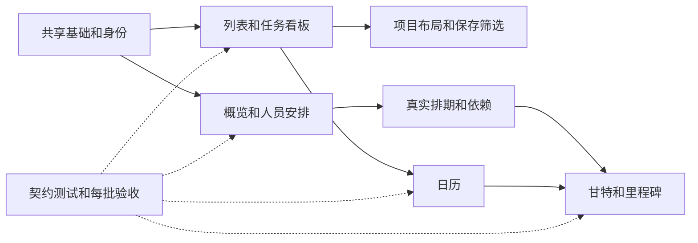

# 项目与任务多视图开发计划

规划日期：2026年10月16日。状态：开发中，实际实施与验证见 [开发进度](/Users/yuanjiezheng/develop/pm-system/docs/multi-view-progress.md)。面向产品、前端、后端与测试人员。

本计划交付四种任务视图——列表、状态看板、日历、甘特，以及项目概览、人员安排两个管理入口。项目集合另提供列表、阶段看板和卡片布局；个人可保存常用筛选。优先交付日常执行、项目事实和人员安排，再建设真实排期与依赖。

共拆分 46 项开发任务。每项写明交付范围、复用位置、依赖和验收条件；具体状态以开发进度和对应验收证据为准，不代表相关功能已全部完成。现有列表、统计、编辑、身份、时区和历史能力作为基础复用。

## 1 产品范围与页面安排

| 入口     | 交付内容                                                   | 默认行为                                             |
| -------- | ---------------------------------------------------------- | ---------------------------------------------------- |
| 项目首页 | 项目集合的列表、阶段看板、卡片；独立概览标签               | 保留当前项目列表为默认，允许保存个人默认布局         |
| 项目概览 | 最近进展、本周变化、下一步、待协调事项，辅以阶段和任务统计 | 先呈现事实与行动，逾期数和完成数作为辅助             |
| 全部任务 | 列表、状态看板、日历、甘特                                 | 默认列表、本周工作范围；切换视图保留明确设置的筛选   |
| 单个项目 | 项目概览；本项目任务的四种视图                             | 固定所属项目，复用任务组件和编辑逻辑                 |
| 团队     | 通讯录、人员安排两个标签                                   | 保留通讯录入口；人员安排展示按人分组的任务与工作日期 |
| 活动记录 | 按日期分组的历史时间线                                     | 延续已选布局；排期功能统一命名为甘特，避免混淆       |
| 常用筛选 | 我的任务、本周待协调、逾期未完成，以及用户保存的筛选       | 保存筛选规则，打开时按当前身份、日期和工作区重新计算 |

首期不包含：工时填报和利用率、自动资源调度、跨项目任务依赖、关键路径、工作日历与假期推算、共享视图权限、跨设备偏好同步。这些列入后续任务池，不作为本轮验收条件。

此前体验计划中的“默认紧凑列表、先看事实、全员协作、工作范围独立于截止日”继续保留。新增可选视图扩展原计划的展示范围，首批任务会同步产品文档中的旧后置清单。

## 2 已有能力和代码复用位置

以下为本次规划核对的工作目录状态，实施时应再次检查并行改动。

| 编号 | 现有能力                                   | 复用入口                                                                                                                                                                                                                                                                                                         | 需要补齐                                      |
| ---- | ------------------------------------------ | ---------------------------------------------------------------------------------------------------------------------------------------------------------------------------------------------------------------------------------------------------------------------------------------------------------------- | --------------------------------------------- |
| C01  | 任务字段、叶子任务、状态和图校验           | [types.ts](/Users/yuanjiezheng/develop/pm-system/packages/domain/types.ts)                                                                                                                                                                                                                                       | 共享查询投影；后续排期与依赖字段              |
| C02  | 跨项目任务范围、状态、搜索和 URL 筛选      | [task-focus.ts](/Users/yuanjiezheng/develop/pm-system/apps/web/src/composables/task-focus.ts)、[TasksView.vue](/Users/yuanjiezheng/develop/pm-system/apps/web/src/views/TasksView.vue)                                                                                                                           | 人员筛选、视图参数、日期口径、共享统计        |
| C03  | 任务树、完成、快捷字段、作废与编辑         | [TaskList.vue](/Users/yuanjiezheng/develop/pm-system/apps/web/src/components/TaskList.vue)、[TaskEditor.vue](/Users/yuanjiezheng/develop/pm-system/apps/web/src/components/TaskEditor.vue)                                                                                                                       | 多视图共同使用的详情容器与动作入口            |
| C04  | 项目筛选、排序、阶段、近期事实与展开编辑   | [ProjectsView.vue](/Users/yuanjiezheng/develop/pm-system/apps/web/src/views/ProjectsView.vue)、[ProjectDetail.vue](/Users/yuanjiezheng/develop/pm-system/apps/web/src/views/ProjectDetail.vue)                                                                                                                   | 拆分项目布局；概览范围和下钻一致              |
| C05  | 阶段和任务统计                             | [stage-summary.ts](/Users/yuanjiezheng/develop/pm-system/packages/domain/stage-summary.ts)、[TaskDistribution.vue](/Users/yuanjiezheng/develop/pm-system/apps/web/src/components/TaskDistribution.vue)                                                                                                           | 按同一范围聚合，增加任务 ID 明细和人员维度    |
| C06  | 共享快照、状态回执、撤销、轮询刷新         | [workspace.ts](/Users/yuanjiezheng/develop/pm-system/apps/web/src/stores/workspace.ts)                                                                                                                                                                                                                           | 所有视图共享保存状态，区分写失败和刷新失败    |
| C07  | HTTP 与本地演示契约                        | [contracts.ts](/Users/yuanjiezheng/develop/pm-system/apps/web/src/services/contracts.ts)、[api.ts](/Users/yuanjiezheng/develop/pm-system/apps/web/src/services/api.ts)、[local.ts](/Users/yuanjiezheng/develop/pm-system/apps/web/src/services/local.ts)                                                         | 新批量接口和排期接口在两种模式中语义一致      |
| C08  | Fastify、事务、任务版本、幂等、JSON 持久化 | [app.ts](/Users/yuanjiezheng/develop/pm-system/apps/api/src/app.ts)、[database.ts](/Users/yuanjiezheng/develop/pm-system/apps/api/src/database.ts)                                                                                                                                                               | 原子批量更新、排期图校验、旧客户端字段兼容    |
| C09  | 工作区账号与员工目录、明确身份关联         | [members.ts](/Users/yuanjiezheng/develop/pm-system/packages/domain/members.ts)、[directory.ts](/Users/yuanjiezheng/develop/pm-system/packages/domain/directory.ts)、[DirectoryView.vue](/Users/yuanjiezheng/develop/pm-system/apps/web/src/views/DirectoryView.vue)                                              | 按稳定身份分组；人员任务页；选择人员时保存 ID |
| C10  | 个人关注、账号隔离存储、编辑草稿           | [account-storage.ts](/Users/yuanjiezheng/develop/pm-system/apps/web/src/services/account-storage.ts)、[project-following.ts](/Users/yuanjiezheng/develop/pm-system/apps/web/src/services/project-following.ts)、[editor-drafts.ts](/Users/yuanjiezheng/develop/pm-system/apps/web/src/services/editor-drafts.ts) | 默认视图、命名筛选、存储迁移和失败提示        |
| C11  | 工作区时区和日期边界                       | [time-zone.ts](/Users/yuanjiezheng/develop/pm-system/packages/domain/time-zone.ts)、[calendar.ts](/Users/yuanjiezheng/develop/pm-system/apps/web/src/composables/calendar.ts)                                                                                                                                    | 日历事件投影、午夜和前台恢复时重算            |
| C12  | 历史时间线、可读变更、作废生命周期         | [ActivityView.vue](/Users/yuanjiezheng/develop/pm-system/apps/web/src/views/ActivityView.vue)、[activity-presentation.ts](/Users/yuanjiezheng/develop/pm-system/apps/web/src/composables/activity-presentation.ts)、[task-lifecycle.ts](/Users/yuanjiezheng/develop/pm-system/packages/domain/task-lifecycle.ts) | 新排期字段的历史展示、恢复和生命周期校验      |

当前已知性能缺口：历史合成基准在 200 个项目、5000 个叶子任务下，项目列表筛选 p95 为 280.4 和 363.1 毫秒，尚未达到 200 毫秒目标。这是旧基准结果，需在实施分支重新测量，不能作为新视图已通过的证据。见 [筛选性能报告](/Users/yuanjiezheng/develop/pm-system/docs/filter-performance.md)。

## 3 所有任务共同遵守的规则

### 3.1 任务集合与计数

1. 先从完整任务图判断叶子任务，再排除作废项并应用筛选。不能先筛子任务，再把父任务误算为一条工作。
2. 列表可以补齐祖先作为上下文；父节点不重复计数，也不提供独立完成操作。项目数、任务数、日期事件数分别标注。
3. 看板各状态列合计等于当前匹配任务数。日历和甘特另显示“匹配任务数、当前日期窗口内任务数、未排期数”，可见窗口不能假装代表全部结果。
4. 一条任务安排三天，日历可有三个事件，周任务总数仍为一条。风险标签可以重叠，逾期数与待协调数不可直接相加当总数。
5. 当前工作区内成员共享项目和任务；负责人、项目参与者、部门筛选均不构成访问权限。管理员设置权限继续独立。

### 3.2 日期与排期

| 字段或范围                     | 含义                         | 必须保持的规则                                     |
| ------------------------------ | ---------------------------- | -------------------------------------------------- |
| `workWeek`、`workDates`        | 某周及该周具体哪些天安排工作 | 所有工作日属于同一个工作周；决定今天和本周工作范围 |
| `dueDate`                      | 明确截止日                   | 只用它判断逾期；不反向生成工作安排                 |
| `estimatedDate`                | 预估日期                     | 独立展示，不算逾期，不当成工期起点                 |
| `reminderAt`                   | 带时区偏移的跟进时刻         | 按瞬时值保存、按工作区时区展示；不代表任务持续时间 |
| `scheduleStart`、`scheduleEnd` | 拟新增的计划起止日期         | 支持跨周，和工作安排、截止日彼此独立               |
| 当前日期窗口                   | 日历当前月、周或甘特显示范围 | 仅控制日期窗口，不静默改写用户的工作范围筛选       |

首版任务日历默认按截止日期展示，可切换工作安排。预计日期与提醒时间随后在同一日历批次接入。若用户仍筛选“本周安排”，跨月浏览继续保留这一筛选，并明确提示；提供显式“清除工作范围限制”操作。

纯日期始终保持 `YYYY-MM-DD`，不通过浏览器当地午夜转换。今天、自然周、提醒显示、相对筛选均使用工作区时区；已有 UTC 工作区不被自动改成上海时区。

### 3.3 保存和恢复

所有视图通过同一动作入口写入。拖动阶段只改阶段，拖动状态只改状态，拖动截止日只改截止日。请求使用现有实体版本、幂等键、CSRF 和工作区会话。

界面区分四种结果：尚未提交的预览；写入明确失败；写入结果不明；写入成功但后续刷新失败。409 不覆盖别人修改；丢响应先核对并使用同一幂等键重试；已确认成功的写入不能因为刷新失败而显示回旧值。操作撤销使用受版本保护的现有恢复机制，不能用旧对象强行覆盖。

批量修改首期提供结果清单和逐条历史恢复入口，不承诺一键整批撤销。若后续增加整批撤销，必须新增整批版本校验和事务，不能把串行调用单条恢复包装成原子撤销。

## 4 页面状态和接口草案

下表为拟新增或扩展协议，具体类型在 MV001 和 MV004 中冻结。原有链接继续兼容。

| 入口       | 路由和状态建议                                                                |
| ---------- | ----------------------------------------------------------------------------- |
| 项目集合   | `/projects?tab=projects&view=list`，`view` 可为 `list/board/cards`            |
| 工作区概览 | `/projects?tab=overview`                                                      |
| 全部任务   | `/tasks?view=list&scope=week`，`view` 可为 `list/board/calendar/gantt`        |
| 项目任务   | `/projects/:id?tab=tasks&view=list`，项目 ID 由路径固定，拒绝相矛盾的项目参数 |
| 项目概览   | `/projects/:id?tab=overview`                                                  |
| 人员安排   | `/directory?tab=work&scope=week`；原通讯录为 `tab=members`                    |

任务筛选扩展 `assignee`、`risk`，保留 `scope/status/project/q/focus`。`assignee` 采用单一表达：缺省为全部、`me` 为当前账号、`none` 为未分配、`member:<id>` 为指定账号；未关联姓名采用独立的 `text:<编码后的姓名>` 值。概览下钻如需多个项目，使用经过校验的项目 ID 集合；查询范围不合法时明确报错，不能放宽为全部。

日历扩展 `dateBasis=due/work/estimated/reminder`、`date=YYYY-MM-DD`、`calendarMode=month/week/agenda`；甘特扩展时间窗口和缩放参数。保存筛选时另存 `anchorMode=relative/absolute`：默认跟随今天，仅明确固定日期才保存绝对窗口。查询条件中显式 URL 优先于个人默认值。搜索使用 replace，主动切换视图使用 push；保留 `/demo` 基址、任务深链和现有 `intake` 参数。

核心读取继续使用共享快照和领域选择器，不为每个布局各开一套查询接口。概览期间活动复用 `WorkspaceApi.activityPage()` 和既有 `/api/activity/query`：`total`、`projectCount`、`completionActions`、`days` 已来自完整匹配范围，`events` 为分页明细。首期不增加重复摘要接口，不能用快照中截断的历史预览冒充完整统计。

| 拟新增接口                        | 作用与关键约束                                                                                           | 所属任务 |
| --------------------------------- | -------------------------------------------------------------------------------------------------------- | -------- |
| `POST /api/tasks/bulk-update`     | 更新明确选中的现有任务；最多 100 条；每条 `id/version`；单次统一修改状态、负责人或截止日期之一；整批事务 | MV010    |
| `PATCH /api/tasks/:id/schedule`   | 修改单条排期或里程碑；携带实体版本，保留其他字段                                                         | MV034    |
| `POST /api/tasks/schedule-batch`  | 明确选择的排期批量变更；逐项版本和读图 revision；整批成功或整批失败                                      | MV034    |
| `PUT /api/tasks/:id/dependencies` | 替换当前任务的前置关系；校验图完整性和版本                                                               | MV035    |

以上名称须避免与已有的“批量创建任务”接口混用。新增契约同时进入 HTTP 和 local adapter。首期个人偏好无新服务端 API。

## 5 开发任务清单

角色：产品负责交互与口径；前端负责页面、状态与适配；后端负责领域、事务和兼容；测试负责独立验收。P0 表示必须先保证的正确性基础，P1 为首期交付，P2 为后续完整能力。以下 C 编号对应第 2 节代码入口。

### 5.1 共享基础

#### MV001 冻结范围与交互契约

- 优先级 P0；主责产品和前端；依赖无。
- 产出页面结构、四种任务视图切换、项目和人员入口、日期口径、统一空状态及桌面和手机低保真稿。确定新增视图默认关闭，逐个完成后开放。
- 为“列表筛选后切看板”“概览数字下钻”“日历改截止日”“人员页重新分配”“甘特排期”各写一条完整用户路径；同步产品文档的后置清单。
- 验收：每个入口明确对象粒度、默认范围、可执行动作及返回位置；没有把项目阶段当任务状态，没有把活动历史当排期。

#### MV002 统一任务筛选与计数

- 优先级 P0；主责领域和前端；依赖 MV001；复用 C01、C02、C05。
- 产出共享 `TaskViewSpec` 和纯选择器：匹配叶子任务、祖先上下文、状态计数、未分配数、逾期和未安排集合。加入稳定 ID 人员筛选、明确风险筛选，建立项目和人员索引。
- 祖先上下文与真正命中任务分开返回；视图禁止各自重新判断叶子或逾期。日期窗口投影放在共享业务筛选之后。
- 验收：混合父子、作废、过滤掉子项、无日期、同名成员样本逐 ID 对账；同一语义筛选在各入口得到一致结果。

#### MV003 统一项目集合与统计范围

- 优先级 P0；主责前端和领域；依赖 MV001；复用 C04、C05。
- 抽出项目搜索、阶段、渠道、分类、负责人、专业、关注、排序，输出项目集合及对应任务集合。待归属收件箱继续单列，所有项目布局共用。
- 概览默认按工作区业务项目计算；用户切到“当前筛选范围”后，所有指标和明细都由同一项目集合派生。明确项目负责人和任务负责人是不同筛选字段。
- 验收：三种项目布局 ID 集合一致；切范围时标题、数值和下钻同步，不出现卡片显示全工作区、明细却显示部分项目的情况。

#### MV004 建立 URL 状态和视图容器

- 优先级 P0；主责前端；依赖 MV002、MV003；复用 C02、C04 和路由入口。
- 实现第 4 节状态协议、非法值回退、旧链接兼容、浏览器前进后退；抽出共享筛选工具栏和视图切换器。不同布局按需加载。
- 保存每种布局的滚动和展开状态；切换时检查未保存编辑；视图尚未交付时不显示可点击的空入口。
- 兼容 `/projects/:id#task-xxx`：任务锚点自动进入任务标签并打开详情，优先于缺省概览；原文追溯锚点进入对应内容。分页或虚拟化之外的目标也能定位。
- 验收：复制链接、刷新、返回均恢复相同选择；项目详情不泄漏其他项目任务；演示路径正常；筛选变化不产生重复加载和死循环。

#### MV005 统一任务和项目修改入口

- 优先级 P0；主责前端和后端；依赖 MV002、MV003；复用 C06、C07、C08。
- 建立共享动作层，覆盖状态、负责人、日期、项目阶段。复用状态回执、版本与幂等机制，统一忙碌、错误、重试、撤销和刷新结果。
- 拖动仅产生临时预览；提交后按已确认回执更新快照。共享业务数据不由各个组件直接乐观覆盖。轮询时保留当前编辑器的基础版本。
- 验收：409、401、403、断网、提交后丢响应、成功后刷新失败分别得到正确结果；同列放置或值未变化不产生写入和活动记录。

#### MV006 提供共享任务详情入口

- 优先级 P0；主责前端；依赖 MV004、MV005；复用 C03、C10。
- 新建任务详情容器，组合现有编辑器、任务复核、完成、作废、项目和父级导航；列表、卡片、日历、人员行、甘特共同打开它。
- 桌面侧面板、手机全屏；继续支持快速字段编辑。编辑草稿按任务和账号隔离，深链能打开指定任务；筛选外任务显示明确提示。
- 验收：关闭后焦点返回触发点；Esc、返回、切视图遵守现有未保存保护；子任务与父级导航正确；作废任务以适当只读状态展示。

#### MV007 统一个人视图存储基础

- 优先级 P0；主责前端；依赖 MV004；复用 C10。
- 建立带版本的偏好存储，按运行模式、工作区、账号隔离，校验结构和大小；默认布局、列、分组、排序共用该基础。旧全局项目排序偏好最多一次复制到当前账号，不能污染其他账号。
- 处理损坏数据、存储被禁用、写入失败、账号切换和未来版本。显式 URL 始终覆盖默认设置。
- 验收：账号和演示模式之间不串数据；偏好故障不阻断任务工作；界面不会把失败保存显示成成功；不存储业务快照或任务正文。

### 5.2 任务列表与状态看板

#### MV008 完善任务列表分组与父子上下文

- 优先级 P1；主责前端；依赖 MV002、MV006；复用 C03。
- 支持不分组、按项目、按负责人、按状态分组；跨项目默认扁平列表，项目内可展开任务树。长标题保留全文入口，父级路径可见。
- 展开状态独立于业务数据；同一任务只在一个业务分组中出现，祖先上下文明确标识，不参与组内数量。
- 验收：分组前后匹配任务 ID 和总数不变；分组折叠不改变统计；过滤后仍能理解子任务所属上下文。

#### MV009 完善列表排序和字段显示

- 优先级 P1；主责前端；依赖 MV007、MV008。
- 支持截止日期、最近更新、标题排序；空值稳定置后并使用 ID 作最终稳定排序。提供字段显示与密度设置，保留标题和必要动作。
- 状态、负责人、截止日期复用快捷编辑；手机减少次要列，通过详情查看完整内容。完成控件和状态菜单保持同一状态写入逻辑。
- 验收：刷新恢复设置；排序不修改任务业务顺序；长内容、中英文、空负责人和无日期均可读；核心操作触控区域不小于 44 CSS 像素。

#### MV010 原子批量修改任务

- 优先级 P1；主责后端和前端；依赖 MV005、MV008、MV017；复用 C07、C08。
- 新增批量修改现有任务契约，首期单次选择一种动作：状态、负责人或截止日。明确选择最多 100 个活跃叶子任务，显示将覆盖的字段与数量；选中范围不等于全部查询结果。
- 后端逐项校验版本、成员身份、父子和作废状态，事务内全部通过才写；每条变更保留活动来源和批次关联信息。清空负责人或日期使用显式动作。
- 清空负责人同时提交 `assigneeId: null` 和空 `assignee`；选择纯文字姓名也显式清空旧账号 ID，避免旧关联自动回填。
- 请求拒绝重复目标 ID；冲突响应扩展为 `conflicts: [{ id, reason, currentVersion }]`，同步扩展客户端 `ApiError` 和错误呈现，不能只使用现有单对象 `current`。整批失败不暴露其他工作区任务详情。
- 验收：任一冲突整批不写、可定位冲突任务；重复提交无重复审计；相同值不产生冗余变更；当前页选中和全选语义明确。不依赖已有批量创建接口完成此功能。

#### MV011 展示四列任务看板

- 优先级 P1；主责前端；依赖 MV002、MV004、MV006。
- 新建任务看板与可复用卡片，固定待做、进行中、待协调、已完成四列；卡片展示标题、项目、负责人、截止日和父级路径。
- 使用共享筛选，列头显示准确匹配数；已完成列可折叠；首期使用确定性排序，不建设列内手动排序数据模型。
- 验收：每条匹配任务恰好出现一次，列合计等于匹配数；无负责人、无日期、长标题和没有任务的列均有完整表现。

#### MV012 看板流转与等价操作

- 优先级 P1；主责前端；依赖 MV005、MV011。
- 桌面支持跨列拖动，落点预览和保存反馈清晰；仅调用状态变更。卡片菜单提供“移动到状态”，作为触摸和键盘等价入口。
- 拖动过程中数据版本更新时取消旧预览并提示重新操作；同列放置无写入；完成后筛选使卡片消失时保留反馈和撤销入口。
- 验收：拖拽、菜单、详情修改结果完全一致；失败不残留卡片副本；移动操作后读屏可获知结果，焦点有可预测落点。

#### MV013 看板规模与窄屏适配

- 优先级 P1；主责前端和测试；依赖 MV011、MV012。
- 大列采用明确分页或按列加载更多，列头数量始终来自完整匹配集合；不为性能静默隐藏卡片。是否虚拟化由 MV044 的测量决定。
- 手机优先单状态列表或可切换列，保留各列计数和状态移动菜单；页面本身不横向溢出。
- 验收：5000 任务样本可找到最后一条匹配任务；切列和返回恢复位置；取消拖动、触摸滚动与点击详情不互相误触。

### 5.3 项目概览与人员安排

#### MV014 建设概览数据投影

- 优先级 P1；主责领域和后端；依赖 MV002、MV003；复用 C05、C11、C12。
- 一次计算范围内项目、状态、待协调、逾期、未安排及可下钻任务 ID；阶段统计沿用现有目录。最近进展直接关联项目事实。
- 本周变化使用既有 `activityPage` 完整范围统计、分页明细和 checkpoint，补写历史后刷新才进入新快照。历史“期间完成操作数”与当前快照“已完成任务数”分别命名；完成后重开再完成不能被误称为多条完成任务。
- 当前状态统计标注快照更新时间，期间变化标注历史范围与读取时刻；两者分别来自快照 revision 和历史 checkpoint，不冒充同一个读取版本。
- 验收：超过 500 条历史仍完整计数；当前筛选和整个工作区模式分明；无日期不算逾期；同一个风险任务可多标签展示但不重复总数。

#### MV015 交付工作区概览与下钻

- 优先级 P1；主责前端；依赖 MV004、MV014。
- 概览先显示最近进展、本周完成和变化、下一步与待协调清单，再放阶段和状态辅助统计。每个数字或条目进入对应任务、项目或活动详情。
- 明示当前范围、工作区时区、数据更新时间；加载、无数据、筛选无结果和刷新失败使用不同状态。避免未经定义的综合健康分或虚假工程进度百分比。
- 验收：卡片显示的 ID 集与打开的明细一致；返回概览保留筛选；刷新失败保留上次有效数据并标注时间，不显示假的零值。

#### MV016 整合单项目概览

- 优先级 P1；主责前端；依赖 MV006、MV014、MV015；复用 C04。
- 项目详情整理为概览与任务入口，概览包括负责人、参与者、阶段、最近汇报、下一事项、待协调和任务摘要；甘特交付后增加近期里程碑。
- 保留现有进展记录、笔记、编辑和原文追溯入口；按项目固定范围复用共享统计，不复制计算函数。
- 验收：所有数据和跳转只属于当前项目；原有快捷编辑与草稿恢复可用；项目不存在、合并后 ID 变化均有可理解的返回路径。

#### MV017 连接稳定人员身份与选择器

- 优先级 P0；主责领域、前端和后端；依赖 MV001；复用 C09 和现有人员选择器。
- `Task.assigneeId` 继续指工作区成员账号 ID；员工通过目录 `employee.userId` 显式关联账号。选择已关联人员时同时保存 ID 和展示名，输入纯文本时明确清空旧关联。
- 显示同名账号的部门等区分信息。未绑定账号的员工仍可作为文本责任人输入，但任务显示在“未关联姓名”组；不按姓名猜账号，不引入第二套负责人 ID。
- 人员页“在职”依据 `Employee.active`；是否允许新分配依据 `Member.status === 'active'`。两者独立，员工在职不代表已激活工作区账号。
- 验收：同名不同人不合并，改名不丢任务；停用账号保留旧任务但不能新增分配；外工作区 ID 被拒绝；选择新姓名不会偷偷保留旧人的 ID。

#### MV018 建设人员任务分布选择器

- 优先级 P1；主责领域；依赖 MV002、MV017；复用 C01、C09、C11。
- 按成员 ID 分组，另设未分配、未关联姓名、已停用且仍有任务人员；提供部门、成员、项目、状态、工作范围筛选。文字组只表示相同文本，不宣称同一自然人。
- 输出每人唯一任务数、完成/未完成/待协调/逾期数，以及各工作日安排、本周未定日和未安排任务。参加项目不意味着承担项目中全部任务。
- 验收：责任人组相加等于范围总任务数；多日任务周内只计一次；员工多部门仅参与筛选，不重复累计任务；纯文本任务不计入“我的任务”。

#### MV019 交付人员安排页面

- 优先级 P1；主责前端；依赖 MV004、MV006、MV018。
- 团队页增加“人员安排”：左侧人员与汇总，右侧本周每日安排；可展开任务明细。支持“有任务的人”和“全部在职人员”，无账号员工明确标注未关联状态。
- 手机使用按人或按日的议程列表。保留未分配和未关联的独立入口，所有明细复用任务详情。
- 未关联账号的员工显示“尚未建立任务关联”，不把无法确认归属展示为零工作；其可能存在的文字责任任务仍列在未关联姓名组。
- 验收：无员工、有员工无任务、停用人员有任务、筛选为空均有准确状态；页面使用“任务数”和“安排”，不显示没有工时依据的利用率或超负荷结论。

#### MV020 支持人员页调整安排

- 优先级 P1；主责前端；依赖 MV005、MV010、MV019。
- 通过菜单修改负责人、状态和工作安排；明确选择工作周及具体工作日。批量改负责人复用原子批量接口；批量排周暂不开放。
- 首版以明确表单为主，拖拽分配可随后接入同一动作；跨周移动展示完整的新工作周和新日期集合，由用户提交，禁止丢弃原工作日而无提示。
- 验收：重新分配后原人和新人数同步变化；改安排不改截止日；版本冲突保留选择供核对；通讯录管理员权限不会错误限制普通成员调整业务任务。

### 5.4 项目布局与常用筛选

#### MV021 拆分并稳定项目列表

- 优先级 P1；主责前端；依赖 MV003、MV004、MV005；复用 C04。
- 将项目列表从大页面中拆出，保留负责人、最新进展、任务展开、关注和快捷编辑。手动排序仅在手动模式中开放。
- 项目排序拖动、移动阶段和项目合并必须是不同动作；项目合并使用明确菜单与既有确认流程，不能在普通拖动中误触。
- 验收：现有项目读写功能无回退；排序不更改阶段或合并项目；进入详情再返回恢复范围、滚动和展开状态。

#### MV022 交付项目阶段看板

- 优先级 P1；主责前端；依赖 MV003、MV005、MV021。
- 按配置的阶段目录建列，卡片显示项目名、负责人、最新进展、下一步和必要任务摘要。沿用阶段颜色和目录顺序，待归属收件箱不进入业务阶段列。
- 拖动只改变阶段；归档阶段保留已有项目展示但不允许新移入；异常旧阶段进入明确的待整理区域。
- 验收：全部可见列及待整理区域合计等于项目集合；普通移动不改变任务状态；键盘与手机可用“移动到阶段”菜单完成操作。

#### MV023 增加项目卡片布局

- 优先级 P2；主责前端；依赖 MV021、MV022。
- 复用项目看板卡片主体，提供自适应宫格；保留项目事实、负责人、阶段、关注和明细入口，允许紧凑和舒展密度。
- 卡片布局继续使用相同项目筛选和排序，不增加业务字段或独立编辑逻辑。
- 验收：列表、阶段看板和卡片的项目 ID 集一致；卡片菜单不会误触导航；手机一列、平板与桌面自动布局，长进展不会撑坏页面。

#### MV024 保存个人默认展示方式

- 优先级 P1；主责前端；依赖 MV007、MV009、MV021。
- 分别保存项目集合、全部任务、项目内任务的默认布局、分组、排序、列和密度；项目内默认使用个人通用模板，避免为每个项目无限写入偏好。
- 用户显式“设为默认”后才持久化；临时筛选不改变默认配置。提供重置入口。
- 验收：不同账号和运行模式隔离；带视图参数的链接优先；未交付或已关闭视图回退到列表并说明；偏好不进入工作活动流。

#### MV025 保存和维护命名筛选

- 优先级 P1；主责前端；依赖 MV004、MV007、MV024。
- 支持保存、重命名、覆盖更新、删除和排序个人筛选；每个账号和模式最多 20 条，名称 1 至 40 字符。保存查询规则与展示参数，不保存任务结果。
- 相对日期保存 today/week 等规则；“我的任务”保存相对当前账号规则。日历窗口默认 `anchorMode=relative`，不把自动生成的当前日期锚点固化；用户明确固定日期时才保存绝对窗口。引用已删除项目或人员时提示修正，不静默扩大为全部结果。
- 项目内保存项首期作为可复用模板，排除项目 ID，始终应用到当前项目；固定项目快捷入口使用指向该项目的普通链接，不能覆盖另一个项目详情的路径范围。
- 验收：跨周再次打开，任务范围和相对日历窗口同步更新；项目 A 保存的模板在 B 应用时只显示 B 的任务；仅应用筛选不写业务数据；损坏、超限和存储失败可恢复；删除筛选不删除任务。

#### MV026 提供常用筛选和分享链接

- 优先级 P1；主责前端；依赖 MV017、MV025。
- 内置我的任务、本周待协调、逾期未完成、未分配四个快捷入口；每个入口能展示当前规则并转为个人保存项。
- 默认规则固定为：我的任务＝当前账号＋全部时间＋未完成；本周待协调＝本周工作安排＋blocked；逾期未完成＝全部时间＋未完成＋明确截止日早于今天；未分配＝全部时间＋未完成＋没有账号关联且姓名为空。入口不会继承上一次互相冲突的状态筛选。
- 复制普通查询链接时明确“我的任务”按打开者本人解析；固定人员筛选保留指定 ID。私有保存项 ID 不作为别人可读取的共享资源。
- 验收：点击预设后的任务 ID 与规则一致；普通分享链接不改变工作区权限；删除个人保存项不使已有普通查询链接失效。

### 5.5 任务日历

#### MV027 实现日历事件投影

- 优先级 P1；主责领域和前端；依赖 MV002；复用 C11。
- 建立截止日和工作安排两种事件投影；再接预计日期和提醒时间。事件有稳定 ID、任务 ID、日期依据和展示时间，多日安排不复制任务实体。
- 工作周已定而日期未定的任务按实际 `workWeek` 分组显示“某月某日当周未定日”；只在当前自然周时简称“本周未定日”。过去周和未来周分别列示，窗口外的周单独计数；其他无所选日期依据的任务进入“未安排此日期”。
- 验收：纯日期在不同时区不漂移；提醒跨午夜落到工作区正确日期；事件数量和任务数量分别准确；全部时间范围中的过去周、当前周、未来周未定日任务不会混成一组。

#### MV028 交付月周与议程布局

- 优先级 P1；主责前端；依赖 MV004、MV006、MV027。
- 提供月、周、议程切换、回到今天、上一段/下一段及日期选择；手机默认议程。按现有主题样式实现，选择组件时核查可访问性、体积和许可证。
- 显示工作区时区、当前日期依据及仍生效的工作范围；拥挤日期使用“更多”展开完整任务。
- 验收：日期点击和任务点击各自作用明确；月初月末、跨年、闰日均正确；所有隐藏在“更多”中的任务可访问。

#### MV029 完成未排期清单和创建入口

- 优先级 P1；主责前端；依赖 MV006、MV027、MV028。
- 在日历旁展示无截止日、按工作周分组的未定日等对应清单，可筛选并进入任务详情。点击日期创建时，把将预填的日期字段展示给用户。
- 全部任务页创建仍需明确项目；工作安排模式预填工作周和日，截止模式仅预填截止日，提醒模式显式填写时刻。
- 验收：未排期任务不会从日历工作流消失；取消创建零写入；只因查看某天不会修改原任务日期。

#### MV030 支持受保护的日期调整

- 优先级 P1；主责前端；依赖 MV005、MV028、MV029。
- 首先支持截止日拖拽及“改日期”菜单；工作安排使用显示完整工作周和日期集合的编辑表单，预计日期和提醒时刻用各自字段编辑。
- 首期不开放多日工作安排的隐式跨周拖动。只有明确提交新日期集合后才替换旧集合；不自动把截止日期同步成排期日期。
- 验收：修改任一日期只影响目标字段；非法日期和不在同周的 workDates 被拒绝；丢响应、冲突和撤销遵守 MV005。

#### MV031 处理日历时间流逝与边界

- 优先级 P1；主责前端和测试；依赖 MV027 至 MV030。
- 工作区午夜、切换时区、标签页重新前台时刷新今天、本周和逾期投影；定时器按工作区边界安排，不使用固定 24 小时推算 DST 日。
- 覆盖上海、UTC、纽约夏令时与半小时 DST 边界；用户当前日期窗口与正在编辑的草稿不因时钟刷新丢失。
- 验收：跨午夜停留页面不持续显示昨天的数据；当前时刻重算不产生业务写入；提醒时刻展示与编辑来回无时间偏移。

### 5.6 甘特排期与任务依赖

#### MV032 增加独立计划排期字段

- 优先级 P2；主责领域和后端；依赖 MV001、MV002；复用 C01、C08。
- 拟新增 `scheduleStart?: date|null`、`scheduleEnd?: date|null`、`milestone?: boolean`。普通任务起止成对设置、开始不晚于结束；里程碑使用同一天起止日期。旧任务保持未排期。
- 字段存入现有 Task JSON，首期无需新增 SQLite 列，也不批量重写旧任务版本。严格区分字段未提供与显式清空；已存在的新字段不能被旧编辑表单遗漏而删除。
- 原始历史快照保留字段存在性，不能先统一补默认空值再判断恢复语义；运行时展示归一化与原始历史读取使用不同步骤。
- 验收：一日、跨周、跨年排期可存；非法日期、单边起止及反向区间被拒绝；原截止、工作安排、预计与提醒字段逐项保持原值。

#### MV033 实现排期图和父任务投影

- 优先级 P2；主责领域；依赖 MV032。
- 构建纯函数计算叶子任务排期、未排期任务、父任务聚合区间、日期窗口内任务和里程碑。父任务范围由全部活跃后代叶子的最早开始与最晚结束计算。
- 存在未排期后代时标识“排期未完整”；所有后代均未排期时不画虚假父条。父条用于分组，不作为额外工时或完成量。
- 验收：20 层以内任务树、部分后代未排期、子任务作废和过滤均有确定结果；筛选不修改原父区间依据；相同输入产生稳定输出。

#### MV034 建立单条和批量排期保存契约

- 优先级 P2；主责后端和前端服务；依赖 MV005、MV032、MV033；复用 C07、C08。
- 实现第 4 节两个排期接口，最多 100 条明确目标。每项带任务版本；批量涉及整体图时校验读取 revision，使用事务与现有幂等机制。
- 只更新明确提交的起止和里程碑字段，取消自动顺延或隐式移动后续任务。响应返回已确认实体和对应版本，local adapter 采用相同校验。
- 验收：任何一项冲突整批不写；同一幂等键重放返回原结果；活动每条可追溯。工作区 revision 按现有审计规则递增，不要求批量只加一次。

#### MV035 实现前置依赖图

- 优先级 P2；主责领域和后端；依赖 MV032、MV034。
- 拟新增 `dependencies?: { taskId: string; type: "finish_to_start" }[]`，保存在后续任务 JSON 中，`taskId` 指前置任务。首期仅同项目叶子任务，里程碑也属于叶子；每项最多 100 个前置关系。
- 硬校验无自依赖、无重复、无环、无缺失及跨项目关系。整个工作区存储图包含作废节点也做结构校验，防止恢复后才形成环。读图、验证、写入在同一事务内完成。
- 日期采用自然日闭区间：前项计划结束日之后才是后项的最早开始日。日期不满足关系或任一方未排期时显示警示，不自动改排期或状态。
- 验收：并发添加 A→B 和 B→A 最多一个成功；添加边不改业务日期；越权 ID 被拒绝且不暴露外工作区内容；删边受任务版本保护。

#### MV036 处理排期图与任务生命周期

- 优先级 P2；主责领域和后端；依赖 MV035；复用 C12 和项目合并逻辑。
- 作废保留排期和依赖历史；活跃任务引用作废前项时标识“前项已作废，待处理”，不能默认为已完成。恢复重新校验关系。
- 跨项目移动涉及依赖时，首期要求在明确动作中解除受影响关系后再移动；项目合并可保留合并后仍合法的关系，但必须整图校验。物理删除被引用任务时拒绝并列出需要处理的关联，不能留下悬空 ID。
- 导入撤销按整个删除集合校验最终图：集合外仍存活或已作废任务的引用都检查，集合内部同时删除的边不误报。扩展 `verifyIntakeUndo()`；服务端读取、验证、删除和审计同事务，local 在克隆状态验证后一次提交，失败不得留下内存半删状态。解除依赖会改变版本，若不再满足原导入撤销资格，则提示采用普通作废路径。
- 叶子转父节点前，明确处理其排期及所有入出依赖：首期提供影响清单，要求先解除依赖并清空独立排期，再新增子任务；界面提供可完成的操作路径。父节点自身不允许写入独立排期。
- 验收：创建子任务、移动、合并、作废、恢复、删除和导入撤销均保持图有效；失败完整回滚；原历史证据保留，不自动转移依赖到某个子任务。

#### MV037 兼容导入导出和历史恢复

- 优先级 P2；主责后端和前端；依赖 MV032 至 MV036；复用 C01、C07、C08、C12。
- 扩展导出模型为版本 3，继续读取版本 1 和 2；导入旧文件时新字段归一化为空，导入整体替换的预览明确提示将失去的已有排期。新文件严格校验引用完整性。
- 版本升级覆盖 `Snapshot.schemaVersion` 类型、`Repository.snapshot()`、local 初始化/读取/导入回填、导出预览、fixtures 与返回契约；替换所有不再适用的版本 2 硬编码。原“版本 2 必须含 catalogs”校验同时适用于版本 3，不能只放开版本数字。
- 可读活动差异增加起止日期、里程碑和前置任务标题；不把内部 ID 直接作为用户文案。按原始历史对象逐字段判断：旧历史缺字段才保留当前值；显式 `null`、`false`、`[]` 按历史值恢复，再校验完整图。整体替换导入采用明确清空规则，不能复用历史恢复合并逻辑。
- 全量 PUT、复制、粘贴、导入、恢复和所有构造 Task 的路径逐一检查字段保留。恢复新历史重新校验版本及依赖图。
- 验收：server/local 实际产出版本 3，版本 3 缺 catalogs 被拒绝；1/2 文件仍可导入；版本 3 往返不丢字段；旧历史缺字段和新历史显式清空分别正确恢复；无效依赖零部分写入，修改普通标题或状态不清除排期。

#### MV038 交付只读甘特布局

- 优先级 P2；主责前端；依赖 MV004、MV006、MV033、MV035、MV037。
- 左侧任务树，右侧自然日时间轴；支持按日、周、月缩放、回到今天、定位任务、折叠父级、未排期清单和里程碑标记。跨项目页面按项目分组，依赖仍限项目内。
- 只在甘特画布内部横向滚动，提供文本排期表作为键盘和手机替代。父条标明聚合性质，依赖线可隐藏以减少拥挤。
- 验收：条形位置与真实日期一致；没有日期不画假工期；任务选择和筛选同步；手机能够查看相同排期事实，即使不使用拖动。

#### MV039 支持手动调整甘特排期

- 优先级 P2；主责前端；依赖 MV005、MV034、MV038。
- 叶子任务可整体移动或调整左右端点，操作前后日期可见；菜单和表单提供相同能力。日粒度吸附，父条首期不可拖动整体平移。
- 依赖时间冲突显示具体前项和冲突日期，保留用户明确安排；不自动推迟其他任务。拖动结束才提交，不在 pointermove 中连续写 API。
- 验收：移动保留工期、拉伸遵守日期校验；一次手势最多一次有效提交；取消、冲突、丢响应后无幽灵条形；修改不影响截止日与工作周。

#### MV040 完成里程碑与依赖编辑体验

- 优先级 P2；主责前端；依赖 MV016、MV035、MV038、MV039。
- 在任务详情中创建/取消里程碑、选择和删除前置任务，明确显示同项目候选、关系含义和日期警示。首期关系编辑用表单；连线拖拽属于可选增强。
- 项目概览显示近期里程碑和需要协调的排期关系；无排期或被作废的前置项有可直接处理的入口。
- 验收：键盘可以完成全部依赖编辑；前置任务改名后显示更新；依赖循环有可理解的错误路径；概览和甘特采用同一实体及日期。

#### MV041 验证排期升级和功能回退

- 优先级 P0，随甘特阶段交付；主责后端和测试；依赖 MV036、MV037、MV040。
- 使用独立旧版本合成数据库升级，核对原字段、版本和历史；新字段读取归一化不触发无意义业务写入。更新所有导入、备份和版本说明。
- 优先通过关闭甘特入口回退功能，同时保留新版兼容读写代码。直接运行旧程序可能丢掉新 JSON 字段，不能当成安全回退；必要时停止写入、保留增量，再从一致备份恢复并对账。
- 验收：升级前后旧业务值一致；重启后排期和依赖持久；关闭功能后普通任务编辑仍保留新字段；独立恢复演练记录数据损失边界和核对结果。

### 5.7 横向验证与交付

#### MV042 建立合成样本和领域契约测试

- 优先级 P0；主责测试和领域；依赖 MV001，随各功能扩展。
- 固定覆盖多层父子、作废、不同项目、四状态、无日期、多日安排、只排周、同名人员、纯文本负责人、未分配、停用账号、跨时区、排期和依赖的样本。
- 在同一输入上核对列表、看板、日历、甘特、概览下钻和人员明细的任务 ID 集；对可见日期窗口、上下文父项及事件重复单独断言。
- 验收：正确性由数据集合证明，不只检查页面出现文字；既有 task-focus、stage-summary、member-links、time-zone、task-lifecycle 测试继续通过。

#### MV043 验证事务和协作失败恢复

- 优先级 P0；主责测试和后端；依赖 MV005；批量和甘特功能接入后追加。
- 使用独立数据库和会话覆盖 409、401/403、断网、丢响应、重复提交、写成功后读取失败；五个独立会话核对轮询同步与编辑草稿保留。
- 对批量任务、排期批量和依赖图验证事务原子性、工作区隔离、CSRF、幂等和审计。local/server 使用同一语义样本对照。
- 验收：无静默覆盖、无重复业务写入、无跨账号残留；重试结果可核验；写入确认后的快照失败不造成假回滚。

#### MV044 完成规模测量和必要优化

- 优先级 P1；主责前端和测试；依赖 MV002、MV003，按已完成视图分批执行。
- 复用历史 200 项目、5000 叶子任务基准，增加父节点、作废项及至多 5000 员工的人员页样本；测进入、筛选缩小/恢复、切视图、切人、切日期和跨视图修改。
- 先优化共享索引、计算依赖和按需加载；若采用分页或虚拟化，必须保留完整查询计数、明确加载范围、深链定位、编辑器生命周期和键盘焦点。原基准样本和口径保留。
- 验收目标：在记录的同一环境下首屏可用 p95≤3 秒、筛选及布局切换 p95≤200 毫秒、健康网络轮询可见 p95≤25 秒；记录 p50/p95/max 和原始样本。未达标如实列缺口，不删慢样本或缩小数据宣布通过。

#### MV045 完成视觉和可访问性验收

- 优先级 P1；主责测试和前端；依赖已完成的页面任务，持续执行。
- 检查 1536、1024、768、390、375 CSS 像素，中英文、深浅色；验证 Tab、方向键、Enter、Escape、焦点返回、读屏名称和结果播报。所有拖动均有菜单或表单替代。
- 演示模式只操作本地合成数据，不请求业务 API；正式模式执行认证写入。手机验证长标题、未分配、日期选择、软键盘和大字缩放，甘特仅内部画布滚动。
- 验收：无非预期页面横向溢出、遮挡、不可达动作和意外控制台错误；保留桌面/手机截图及人工核对记录。模拟视口、axe 和真机结果分别标识。

#### MV046 整合发布批次和实施证据

- 优先级 P1；主责执行负责人和测试；依赖每批相关任务、MV042 至 MV045；甘特批次另依赖 MV041。
- 每批更新状态清单、已知缺口、截图、测试命令与结果、兼容说明、功能开关和恢复步骤；旧列表始终可用。按通过验收的功能开放入口。
- 代码改动按模块评审，先跑针对性测试，再在批次收口执行 lint、typecheck、完整单元/API 回归、相关 E2E 和 build；性能测量与 CPU 密集检查顺序执行。
- 验收：本批主路径、冲突恢复、旧功能回归全部通过，未完成项明确；部署作为独立交付动作安排，文档或测试通过不冒充已经上线。

## 6 数据模型和批量行为示例

以下均为拟新增契约示例，不代表当前代码已有接口。接口的认证、幂等键和请求标识继续沿用现有公共传输层。

```ts
type TaskSchedule = {
  scheduleStart?: string | null; // YYYY-MM-DD，计划开始
  scheduleEnd?: string | null; // YYYY-MM-DD，计划结束，闭区间
  milestone?: boolean;
  dependencies?: Array<{
    taskId: string; // 当前任务的前置任务
    type: "finish_to_start";
  }>;
};

type TaskBulkUpdate = {
  targets: Array<{ id: string; version: number }>; // 1 至 100 个，ID 不重复
  change:
    | { field: "status"; value: "todo" | "in_progress" | "blocked" | "done" }
    | {
        field: "assignee";
        value: { assigneeId: string | null; assignee: string };
      }
    | { field: "dueDate"; value: string | null };
};

type SavedView = {
  schemaVersion: 1;
  id: string;
  name: string;
  context: "tasks" | "projectTasks" | "projects" | "people";
  viewSpec: TaskViewSpec | ProjectViewSpec | PeopleViewSpec;
  createdAt: string;
  updatedAt: string;
};
```

`ProjectViewSpec` 和 `PeopleViewSpec` 在 MV003/MV018 中定义。个人保存筛选不保存读取结果、不写共享 Snapshot、不产生工作活动；当前浏览器内保存范围在界面中明确标注。

父子关系和依赖关系是两张不同的图：父子用于工作分解和汇总，依赖用于先后约束。任何新校验都不能用其中一张图替代另一张。

## 7 分批交付和依赖顺序

任务可按下表分派。负责人是建议职能，不代指已经安排的具体人员。估算包含实现、针对性单测和评审；Q 为独立跨模块回归及交付工作，未重复计算各功能单测。

| 批次              | 任务                                | 可交付结果                                 | 建议主责             |  粗估人日 |
| ----------------- | ----------------------------------- | ------------------------------------------ | -------------------- | --------: |
| R0 共享基础       | MV001 至 MV007、MV017               | 查询口径、路由、动作、详情、身份、偏好基础 | 前端 A、全栈 B、产品 |  12 至 18 |
| R1 执行视图       | MV008、009、011、012、013、021      | 完善列表、任务看板、稳定项目列表           | 前端 A               |   8 至 12 |
| R2 管理入口       | MV010、014、015、016、018、019、020 | 批量修改、工作区与项目概览、人员安排       | 全栈 B、前端 A       |  10 至 16 |
| R3 项目布局与偏好 | MV022 至 MV026                      | 项目阶段看板、卡片、默认布局、命名筛选     | 前端 A               |   6 至 10 |
| R4 日历           | MV027 至 MV031                      | 月周议程、未排期、日期编辑、边界处理       | 前端 A、全栈 B       |   9 至 14 |
| R5 排期数据       | MV032 至 MV037                      | 排期、依赖、生命周期、导入导出和历史兼容   | 全栈 B               |  10 至 16 |
| R6 甘特交互       | MV038 至 MV041                      | 甘特、里程碑、手动排期与升级回退证据       | 前端 A、全栈 B       |   8 至 12 |
| Q 持续验收        | MV042 至 MV046                      | 正确性、协作、规模、设备和每批交付证据     | 测试、开发共同修复   |   8 至 12 |
| 合计              | 46 项                               | 完整本轮范围                               |                      | 71 至 110 |

容量假设为 2 名开发和兼职产品/测试；排期粗估 9 至 14 周，R0 完成后按实际吞吐重估。首个列表/看板可试用批次约 3 至 4 周；概览和人员安排优先于复杂甘特。若只有 1 名开发，按人日与依赖串行排期，不沿用双人周数。

R0 之后，前端推进 R1，领域/后端可并行推进 R2 的投影、批量接口和人员分布。R2 的页面依赖共享详情和身份，但不依赖甘特。R5 可在管理入口稳定后与 R4 并行；R6 必须等待 R5 兼容验收。R3 中卡片布局 MV023 最先允许延后，不能挤占身份、冲突恢复和时间口径。



### 7.1 首批启动的具体工单

第一轮先启动 MV001、MV002、MV003、MV017 和 MV042。MV001 确定口径后，任务查询和项目查询可分别实现，身份工作可由另一位开发处理。不要先为四个布局分别复制筛选代码。

第二轮接 MV004、MV005、MV006、MV007；随后进入 MV008、MV009、MV011。看板能看之后再接 MV012，而不是用拖拽外观替代保存闭环。

每个工单完成时填写：实际改动文件、用户路径、数据和接口变化、测试证据、剩余缺口。任务发生范围调整时同步改其依赖和验收，不以“页面能打开”作为完成标准。

## 8 业务验收矩阵

| 场景               | 操作                                              | 必须得到的结果                                   | 关联任务        |
| ------------------ | ------------------------------------------------- | ------------------------------------------------ | --------------- |
| 同一筛选跨视图     | 本周＋指定项目＋待协调，依次切列表/看板/日历/甘特 | 匹配叶子 ID 相同；日期窗口内外和未排期明确区分   | MV002、004、042 |
| 父子计数           | 父项有多个子项，筛掉部分子项，再作废一项          | 父项不变成额外工作，完成数和总数不重复           | MV002、008、033 |
| 多日工作安排       | 一项任务本周排三天                                | 三个日事件、一个周任务；人员周汇总仅一次         | MV018、027      |
| 周安排和截止日独立 | 本周工作、下月截止；拖动截止日                    | 仍属于本周工作，原 workDates 不变                | MV027、030      |
| 同名和改名         | 两个同名账号分别负责任务，再改其中一个人的姓名    | 分组保持独立；原任务仍属于原账号                 | MV017、018      |
| 未关联和未分配     | 输入文本责任人，另建空责任人任务                  | 文本待关联组与未分配组独立，不自动认人           | MV017、019      |
| 概览下钻           | 当前项目筛选下点击逾期或待协调数字                | 明细任务 ID 与指标完全一致；返回保留范围         | MV014、015      |
| 完整期间历史       | 在超过 500 条活动的样本中查看本周变化             | 使用完整范围和稳定水位，非截断快照计数           | MV014、042      |
| 拖动失败           | 看板跨列后出现 409 或响应丢失                     | 冲突可理解，结果不明可核验，无重复卡片和重复审计 | MV005、012、043 |
| 批量冲突           | 选择多任务，其中一条被别人修改                    | 全部不写入，指出冲突项，不出现半成功             | MV010、034      |
| 偏好隔离           | A 保存筛选，退出，B 登录，再进入演示模式          | 每个账号、工作区、模式保持独立                   | MV007、024、025 |
| 日期流逝           | 页面停留跨工作区午夜，或从后台回到前台            | 今天、本周、逾期更新，日期字段与草稿不漂移       | MV031           |
| 甘特真实排期       | 无排期、仅截止日、跨周排期混合展示                | 只有真实计划画条形，其余进入未排期               | MV032、038      |
| 依赖和生命周期     | 并发反向加边、作废前项、跨项目移动、叶子转父项    | 无环和引用完整；影响清单明确；不自动猜测迁移     | MV035、036      |
| 旧数据兼容         | 旧数据库升级，修改标题，导出重导入，再重启        | 旧值不变，新排期不丢失，活动可读                 | MV037、041      |
| 移动和键盘         | 不使用鼠标拖拽完成状态、负责人和日期修改          | 所有核心路径可操作，焦点明确，手机不遮挡保存     | MV045           |

## 9 测试入口和交付证据

领域单测扩展现有 [task-focus.test.ts](/Users/yuanjiezheng/develop/pm-system/tests/unit/task-focus.test.ts)、[stage-summary.test.ts](/Users/yuanjiezheng/develop/pm-system/tests/unit/stage-summary.test.ts)、[time-zone.test.ts](/Users/yuanjiezheng/develop/pm-system/tests/unit/time-zone.test.ts)，并新增概览、人员分布、日历投影、排期图测试文件。

API 集成测试复用 [task-field-copy.test.ts](/Users/yuanjiezheng/develop/pm-system/tests/integration/task-field-copy.test.ts)、[task-lifecycle.test.ts](/Users/yuanjiezheng/develop/pm-system/tests/integration/task-lifecycle.test.ts)、[upgrade-backup.test.ts](/Users/yuanjiezheng/develop/pm-system/tests/integration/upgrade-backup.test.ts)，补齐原子批量、排期、依赖和旧字段保留路径。

端到端新增多视图一致性、人员安排、日历和甘特专项；扩展现有 [preferences.spec.ts](/Users/yuanjiezheng/develop/pm-system/tests/e2e/preferences.spec.ts)、[mobile.spec.ts](/Users/yuanjiezheng/develop/pm-system/tests/e2e/mobile.spec.ts)、[time-zone.spec.ts](/Users/yuanjiezheng/develop/pm-system/tests/e2e/time-zone.spec.ts) 和 [demo.spec.ts](/Users/yuanjiezheng/develop/pm-system/tests/e2e/demo.spec.ts)。

```bash
# 各任务先执行相应文件的单元或集成测试
npx vitest run <本批相关测试文件>

# 每批集成后执行已有项目检查
npm run lint
npm run typecheck
npm test
npm run build

# 使用准备好的独立 E2E 环境执行本批浏览器用例
npx playwright test <本批相关测试文件>
```

现有 Playwright 配置会启动 4173 和 3001 端口，且不复用已运行服务。实施测试前需为独立数据库和端口配置隔离环境，不直接拿用户正在使用的本地页面作为会被重置的 E2E 环境。性能测量复用现有脚本的方法，另增视图切换和人员筛选场景；所有计时保存环境与原始样本。

已实现的领域规模基线可在Node24下先执行`npm run build`，再运行`node scripts/measure-gantt-domain.mjs final`与`node scripts/measure-people-domain.mjs`。它们读取本次构建的领域产物，将带时间戳的环境、数据量及原始样本写入docs/evidence，不覆盖旧基线；仅证明Node领域计算，不替代上述浏览器性能门槛。构建与API回归测试需顺序执行，避免dist入口删除期间读取失败。

用户授权独立Playwright后，多视图专项使用`playwright.multi-view.config.ts`。先在Node24成功构建，再将`PM_MULTI_VIEW_TEST_DIR`设置为新建临时目录，执行`npx playwright test --config=playwright.multi-view.config.ts`。专用服务绑定127.0.0.1:4189，可通过`PM_MULTI_VIEW_E2E_PORT`改为另一空闲端口；复用监听或已有数据库会失败。服务复制dist/web和dist/server为本轮固定副本，避免其他聊天的构建或源码热更新混入；测试数据库、账号凭证、会话及报告均在该临时目录，普通E2E数据目录不使用。凭证/会话文件不得复制到交付报告中；仅保留不含凭证的结果、截图和计时样本。

每批交付保留：变更文件和接口列表、通过及失败的检查、桌面和手机截图、日期和身份边界样本、失败恢复证据、已知限制。没有实际执行的检查标为待测；模拟测试与真实设备、生产环境分开报告。

## 10 后续任务池

以下不计入 46 项首轮任务和人日估算，按真实使用反馈再启动。

| 后续能力           | 进入开发前必须具备的条件                             | 拆分方向                                                                                      |
| ------------------ | ---------------------------------------------------- | --------------------------------------------------------------------------------------------- |
| 真正人员负荷与容量 | 有可核验的预计工时、人员可用工时、假期与多人分摊规则 | 分钟单位的任务工作量、按人按日分配、容量日历、实际工时采集；缺失标未知，不用任务数倒推利用率  |
| 个人视图跨设备同步 | 明确需要跨设备，已有本地偏好模型稳定                 | 私有 `saved_views` 表，工作区＋owner 双重隔离、独立版本和 409；不进入共享工作活动或工作区导出 |
| 团队共享视图       | 明确维护者、共享范围、默认视图控制权                 | 在私有视图稳定后单独设计共享权限，不能直接放开私人视图 ID                                     |
| 项目组合排期       | 项目级目标日期和里程碑来源明确                       | 区分项目承诺日期与任务聚合日期，增加项目时间轴，首期仍不跨项目连任务依赖                      |
| 高级排期           | 基础排期可信且有真实需求                             | 工作日历、时滞、关键路径、基线比较、自动顺延，每项独立建模和验收                              |

## 11 产品参考

视图分类参考 [Tower 四大项目视图](https://tower.im/blog/articles/2902) 和 [Asana 项目视图说明](https://help.asana.com/s/article/filter-and-save-views)。概览与人员管理参考 [Asana 项目仪表盘](https://help.asana.com/s/article/project-dashboards) 和 [工作量说明](https://help.asana.com/s/article/reporting-with-workload)。这些来源支持能力划分；本计划的任务范围、数据规则和实施顺序依据当前系统及本次讨论确定。

现有产品约束和历史交付参考 [产品范围](/Users/yuanjiezheng/develop/pm-system/docs/product.md)、[工作区时区](/Users/yuanjiezheng/develop/pm-system/docs/workspace-time-zone.md)、[个人偏好与草稿](/Users/yuanjiezheng/develop/pm-system/docs/personal-work.md) 和 [体验改进计划](/Users/yuanjiezheng/develop/pm-system/docs/improvement-plan.md)。
