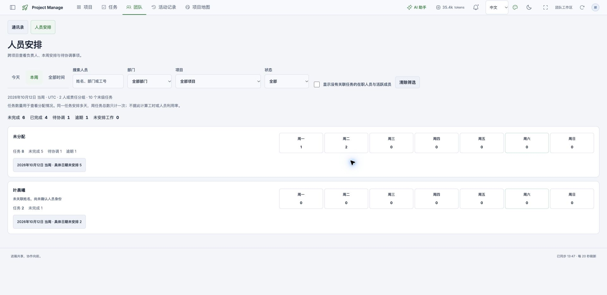
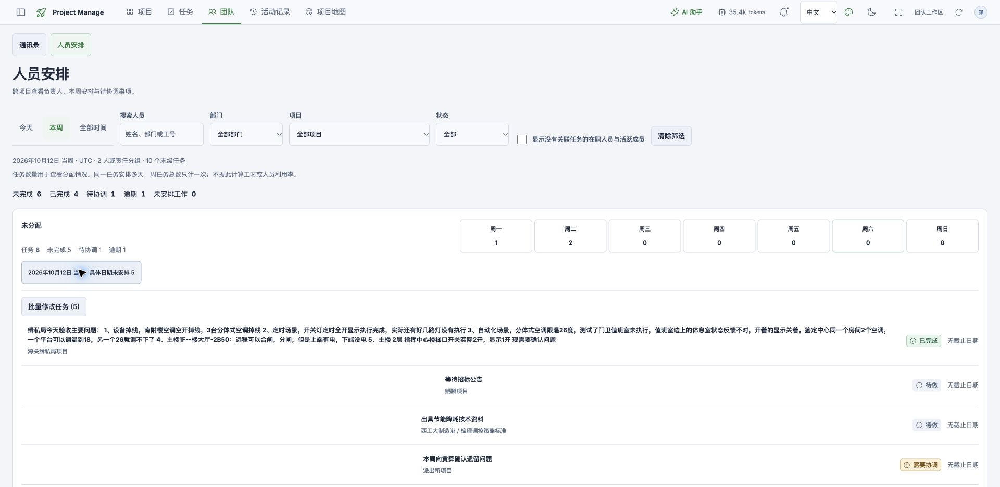
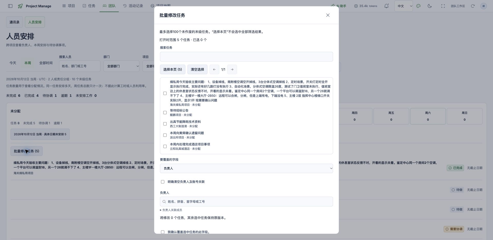

# 人员安排重规划：团队工作台

> 2026-10-17 范围修订：用户已明确当前只需要人员与项目相关的统计分析，采用简洁汇总、表格及少量图表。日报处理、任务生成和复杂排班不在当前范围；下文原始功能扩展与人日估算作为历史讨论保留，不作为当前开发依据。后续先以简化统计效果图确定方向。

日期：2026-10-17。状态：规划完成，待分批实施。依据为本地实际数据库、当前工作目录代码及本次浏览器只读走查；不是生产环境验收，也未执行人员认领、任务分派或日期修改。

## 1. 产品目标与结论

将现有“人员安排”升级为“团队工作台”，让管理者完成三个连续动作：发现需要处理的事项，核对并分派责任人，安排工作并跟进变化。

当前首要问题是责任身份和工作时间缺失，大面积周历无法补足这些事实。默认入口应为可操作的协调清单；人员列表用于跨项目看工作，周安排用于查看和调整具体日期。通讯录保留为人员主档入口。

优先复用已有筛选、任务详情、人员选择器、原子批量修改和审计体系。工时利用率、绩效排名、自动最优排班不纳入本轮。

## 2. 实际数据基线

来源：[只读统计证据](evidence/people-work-planning-baseline-2026-10-17.json)。数据库为 `data/project-manage.sqlite`，工作区 revision 148、时区 UTC。以下数字是本次快照，实施时应重新读取，不能写死到页面。

| 事实 | 当前数量 | 对规划的影响 |
| --- | ---: | --- |
| 项目 | 39 | 需要跨项目工作入口 |
| 有效末级任务 | 113 | 排除父任务和作废任务，作为可对账的任务范围 |
| 未完成 / 已完成 | 84 / 29 | 待处理默认关注未完成，已完成可另行查看 |
| 任务稳定账号负责人 | 0 / 113 | 当前无法可靠按真实人员汇总全部任务 |
| 仅文字负责人 / 未分配任务 | 10 / 103 | 必须提供身份核对及分派入口 |
| 未完成且未分配 | 78 / 84 | 是跨时间待处理事项，不能被本周筛选隐藏 |
| 未完成且没有工作周或工作日 | 78 / 84 | 需要先排入工作计划；与未分配集合有重叠，不能相加 |
| 有工作周 / 有具体工作日 | 10 / 3 | 先支持排周及补具体日期，不要求一次填写完整日程 |
| 有截止日期 | 6 / 113 | 逾期提示仅覆盖有明确截止的任务 |
| 计划起止、依赖、里程碑 | 均为 0 | 甘特或依赖分析不能成为此页面的主内容 |
| 部门 / 在职员工 | 5 / 17 | 通讯录已具备人员与组织基础 |
| 活跃账号 / 已关联账号的员工 | 1 / 1 | “必须先有账号才能稳定分派”不适合当前数据覆盖 |
| 有文字项目负责人 / 稳定项目负责人 ID | 33 / 0 | 项目责任可成为核对线索，不能直接冒充任务执行人 |
| 有最新进展的项目 / 日报批次 | 32 / 0 | 可展示项目进展，不宜先建设个人日报统计 |

截图对应 2026-10-12 当周：10 个末级任务，6 未完成、4 已完成；8 未分配、2 仅文字负责人；3 有具体工作日、7 只安排到周。这是“本周安排任务的当前状态”，不是“本周新完成 4 项”。

进一步核对：本周 6 个未完成任务中，1 个有具体工作日、5 个只排周。全部日期下，78 个未分配与 78 个未排计划有 73 个重叠，合并后为 **83 个待分派或待排计划事项**。此数不是所有风险队列的并集，不应与待协调或身份待确认数量相加。

数据解释必须保留四条边界：没有任务关联不代表没有工作；任务数不代表工时或利用率；编辑者、汇报人、项目负责人和执行人不是同一个角色；没有截止日期不代表不存在交付风险。

## 3. 当前流程走查

走查现有登录页面 `http://localhost:4173/directory?tab=work`，只展开列表、查看批量窗口并关闭，未提交任何业务变更。截图均为本轮采集。

### 步骤 1：进入本周人员安排——信息不足，统计范围容易误解

已有部门、项目、状态和人员筛选，并明确提醒任务数不等于工时。主要问题是首屏只有责任分组和数字，看不见具体项目与事项；未分配组和未确认姓名占据普通人员位置；大量零值日格不能帮助决策。

“本周”先按工作周过滤，再统计“无工作周/工作日”，导致“未安排工作 0”掩盖跨时间的安排缺口。应分别显示“本周待定日”和“全部日期待排计划”，两者明确标范围。

### 步骤 2：展开未定日任务——可查看，但阅读效率低

任务标题、项目、状态和截止信息已有展示；但长任务标题横跨屏幕，短标题居中，扫描路径不一致。建议任务标题统一左对齐、两行摘要、完整内容在详情中查看，增加直接分派和安排日期动作。已完成事项默认收起，避免占据协调清单。

### 步骤 3：打开批量修改——基础能力已存在，可复用

已支持逐项勾选、最多 100 项、负责人/状态/截止日期修改以及覆盖确认。规划应提升入口可见性并扩充工作安排能力，不重复开发整套批量框架。本次仅检查窗口，未验证保存、冲突或失败恢复。

可访问性观察：现有筛选有标签，日期有可读名称，展开状态有表达；浅色辅助文字和长内容需要进一步检查。键盘全流程、屏幕阅读器、对比度数值与手机布局本轮未验收，不能宣称通过无障碍检查。

## 4. 新功能结构

保留“团队”导航及通讯录，工作入口建议改名“团队工作台”。其内部提供三个视图，沿用现有样式、任务详情侧栏和筛选习惯。

| 视图 | 主要回答的问题 | 页面内容 | 可直接执行的动作 |
| --- | --- | --- | --- |
| 协调总览（默认） | 现在先处理什么？ | 未分派、身份待确认、未排计划、本周待定日、待协调、明确逾期；下方统一事项列表 | 筛选、分派负责人、安排到周/日、打开详情、批量处理 |
| 人员总览 | 每个人负责哪些事？ | 紧凑人员表：人员/部门、任务涉及项目、未完成、待协调、明确逾期、未排计划、身份状态 | 查看个人侧栏、按部门/项目筛选、风险排序、处理个人任务 |
| 周安排 | 哪天做什么，哪些还没落到日？ | 人员×周一至周日矩阵，独立“本周待定日”列；格内显示项目和任务摘要 | 上周/本周/下周、日期定位、安排/调整日期、打开任务 |

协调总览首屏应先露出待处理清单。高频筛选为部门、项目和人员；低频条件收入展开筛选。只读指标与可操作入口不能使用同一种无提示样式。

任务列表建议列为：任务与项目、负责人、工作安排、截止日、状态、问题标签、操作。同一任务有多个问题时显示多个标签，主列表按任务 ID 去重。手机使用按人/按日议程，任务操作保留点击路径，不依赖拖拽。

人员侧栏分开显示“执行的任务”“负责的项目”“近期操作/项目进展”。项目参与记录目前由编辑操作自动登记，不能作为真实执行团队或工作量依据；未经确认的项目责任只作为待核对线索。

## 5. 指标与范围契约

| 指标 | 定义 | 范围与行为 |
| --- | --- | --- |
| 待分派 | 未完成末级任务，无稳定责任引用且无文字负责人 | 全部日期，受明确的项目等业务筛选限制 |
| 身份待确认 | 未完成任务仅文字负责人，或引用身份失效 | 同时显示任务数与文字组数；姓名组不是人数 |
| 待排计划 | 未完成且没有工作周、工作日 | 全部日期；不能受展示周过滤 |
| 本周待定日 | 所选周内未完成，只有工作周、无具体工作日 | 受展示周限制；已完成数量另行标记 |
| 待协调 | 当前状态为待协调的未完成末级任务 | 默认全部日期；可显式切换到所选周 |
| 明确逾期 | 未完成且明确截止日期早于工作区今天 | 旁示截止日期覆盖情况；切换展示周不改变“今天” |
| 当前已完成 | 所选范围任务目前为完成状态 | 不称为“本周完成量” |
| 期间完成事件 | 可验证的状态变更进入完成，按事件发生时间统计 | 后续才做；事件去重，重开/再次完成规则明确，历史缺失不补造 |

跨时间待办与周视图分别显示自己的范围标题，切换周不改变跨时间待办计数。部门/人员筛选无法归属的任务不能偷偷消失：显示“另有归属待确认事项”独立入口，注明不计入该部门/人员的小计，也不能混入当前批量选择。

所有数字点击后必须落到构成该数字的准确任务集合。负责人、项目等筛选变化后清空过期选择或要求重新核对。汇总与明细采用同一投影结果，不分别拼接统计口径。

工作安排、截止日期、计划起止分开：改工作日只改工作安排；移动到另一周时展示将替换的完整日期集合，保留跨周语义边界；不自动改截止、甘特计划或任务完成状态。

## 6. 人员身份的关键调整

现有 `assigneeId` 是账号 ID，通讯录员工通过 `employee.userId` 关联账号。原计划 MV017 明确不引入第二套负责人 ID。17 名在职员工只有 1 名关联账号，故全员稳定分派需要选择一条明确路径。

**推荐方向：以员工主档作为业务责任身份，登录账号按需关联。** 管理者能够给尚未开户的员工安排工作；账号负责登录、操作审计和消息接收。支持人员安排不应自动授予登录权限或自动开通账号。

这是一项对 MV017 的正式修订提案，本文件不意味着数据模型已变更。进入对应开发批次时形成独立架构决策与迁移设计，明确唯一权威责任引用，覆盖员工、账号型外部协作者、纯文字、未分派四种状态。不能把员工 ID 填进现有账号字段，也不能让两个可写负责人字段互相冲突。

| 必需设计 | 约束 |
| --- | --- |
| 旧字段兼容 | 保留旧账号含义；新旧读写的优先级和校验确定，旧客户端不能静默清空新责任信息 |
| 身份核对 | 同名只生成候选；按部门、工号等辅助核对，逐条或明确选中批量确认；不自动合并 |
| 生命周期 | 改名保留关联；离职保留历史但禁止新分派；账号停用与员工离职分别判断 |
| 通讯录引用保护 | 员工 ID 不重用；存在业务或历史引用时不能直接物理删除，应停用或保留可解析的历史身份；目录整体替换、导入及同步必须核对引用，身份转移需明确映射、预览和审计 |
| 权限 | 分派业务任务沿用现有工作区权限；维护员工、绑定账号仍走管理权限；跨工作区引用拒绝 |
| “我的任务”与通知 | 只通过明确员工—账号关系解析；无账号员工可有任务，但标记无账号通知通道 |
| 迁移与恢复 | 备份、预演、增量迁移、审计、导入导出、历史恢复均保留身份；完成迁移后不能仅回滚前端冒充恢复完成 |

当前 10 条文字责任任务分为 2 个文字组，均有唯一同名员工候选；这仅能降低核对成本，不能作为自动认领的依据。处理历史身份时优先未完成任务，已完成历史另行审阅。

**兼容备选：继续账号模型。** 若实际业务要求每位执行人都必须登录，则由管理员完成必要的开户、激活与显式绑定，再核对历史责任。此路线减少迁移开发，但人员使用门槛和业务准备工作增加；不在本次规划中实际开户。

## 7. 分期开发计划

以下为工作量估算，不是已承诺工期。推荐员工身份路线合计 **16–24 人日**，含领域/API/前端及针对性回归；按 1 名熟悉项目的全栈开发和业务人员及时核对，约 4–6 个工作周。多人可并行视觉与接口工作，但身份契约是共同依赖。发布、业务认领等待和额外需求不包含在估算中。

### R0：先让真实问题可见、可处理，3–5 人日

| 编号 | 工作项 | 主责 | 完成条件 |
| --- | --- | --- | --- |
| TW01 | 固化任务范围、跨时间待办、展示周三类投影；建立数据基线 | 领域/后端 | 指标到任务集合可对账；父级/作废/多日任务不重计 |
| TW02 | 新增协调总览及紧凑问题清单，修正“未安排 0”的误导 | 前端 | 未分派、待确认、待排计划与本周待定日分开；点击可查看准确事项 |
| TW03 | 前移现有详情、批量分派、状态编辑入口；完成态默认收起 | 前端 | 从问题清单可直接处理；不扩大勾选范围；返回保留筛选与位置 |
| TW04 | 验证未关联、无日期、空部门、长标题、筛选零结果 | 测试/产品 | 数据不足显示未知/待核对；不得显示“空闲”结论 |

R0 不依赖身份迁移即可交付。它复用当前可分派账号及文字规则，不宣称已支持全员稳定分派。第一版的价值是让 78 项未排计划事项可见、可逐步处理，而不是自动把历史事项全部塞入本周。

### R1：稳定人员身份与人员总览，8–12 人日

| 编号 | 工作项 | 主责 | 依赖与完成条件 |
| --- | --- | --- | --- |
| TW05 | 责任身份架构决策、兼容契约、迁移预演 | 领域/后端 | 明确推荐路线；旧字段语义不变，旧导出/恢复有可验证策略；目录删除、整体替换、导入及同步具备引用保护设计 |
| TW06 | 员工责任引用贯通任务/项目、选择器、我的任务、审计和通知解析 | 全栈 | 无账号员工可被分派；不自动授予权限；停用/离职及跨工作区校验正确；有引用员工不被直接删除，历史责任仍可解析 |
| TW07 | 历史负责人核对列表，人工确认与版本保护 | 全栈/业务 | 同名不猜测；批量预览显示将改事项；保留原始文字和操作证据 |
| TW08 | 紧凑人员总览、部门分组、人员详情侧栏 | 前端 | 任务执行与项目责任分开展示；未关联状态清楚；数字下钻可对账 |

TW05 确定后才进入 TW06/TW07 写入实现。若选择继续账号模型，R1 调整为 **4–6 人日**，全计划为 **12–18 人日**；管理员开户与业务核对时间另计。两条路线互斥，不叠加开发。

### R2：完成可操作周安排与回归，5–7 人日

| 编号 | 工作项 | 主责 | 依赖与完成条件 |
| --- | --- | --- | --- |
| TW09 | 独立展示周参数、周导航、桌面人员日期矩阵 | 领域/前端 | 显示任务/项目摘要；切周不改变真实今天、逾期基准或原始任务数据 |
| TW10 | 手机按人/按日议程，直接安排日期、跨周修改预览 | 前端 | 375/768/1536 宽度可用；鼠标、触控、键盘均有明确表单入口 |
| TW11 | 批量工作周/工作日能力，复用选择和确认框架 | 全栈 | 扩展实际工作安排契约与原子写入；最多 100 项、版本/幂等保护；不借用甘特日期接口 |
| TW12 | 全流程回归、规模验收及试用反馈 | 测试/开发 | 保存、冲突、断网、重复提交、轮询同步和筛选一致性通过；记录失败与剩余限制 |

拖拽为后续增强，优先完成点击和键盘路径。工作安排批量写入属于对原 MV020“暂不开放批量排周”的有意扩展，要独立测试和验收。

首轮不安排个人日报统计、AI 自动认领、自动排班、工时和绩效。后续可以在稳定身份和足够记录的前提下，提供附来源的变化摘要；跨时间完成趋势需从完整审计查询获取，不能用最近快照/最近 50 条日报推断全部历史。

## 8. 技术落点与既有能力复用

| 现有文件/能力 | 本轮处理 |
| --- | --- |
| `apps/web/src/views/TeamView.vue`、`PeopleWorkView.vue` | 保留原入口兼容，拆分协调/人员/周视图；建议使用 `view`、`week` 查询参数，旧链接仍可达 |
| `packages/domain/people-work.ts`、`task-view.ts` | 增加跨时间队列和独立展示周，不让展示周重定义今天；所有视图共享任务集合 |
| `TaskDetailPanel.vue`、`TaskBulkEdit.vue`、`PersonPicker.vue` | 复用编辑与选择，扩展员工引用和工作安排；不复制第二套写入流程 |
| `task-planning.ts`、`CalendarDateEdit.vue`、任务保存及版本/幂等框架 | 复用单任务工作安排规则，新增或扩展针对 `workWeek/workDates` 的原子批量契约；`task-schedule-write.ts` 属于甘特计划起止写入，仅可参考其事务处理方式 |
| `types.ts`、`directory.ts`、`members.ts`、数据库/快照 | R1 统一责任引用与兼容边界；需同时处理 HTTP 和本地演示实现 |
| 通知、我的任务、导入导出、历史恢复 | 作为身份迁移的回归范围，不能只改人员页面 |
| `tests/unit/people-work.test.ts` 及 API/E2E | 扩展具有业务意义的口径、身份、并发和浏览器用例 |

已有 MV017–020 的基础筛选、分组、详情和批量负责人修改已实现，本轮不再记作新功能。旧计划中手机议程与浏览器规模验证仍须落实。既有文档测试记录不等于本次新方案已通过测试。

## 9. 验收与上线顺序

1. **统计可信。** 每个数能查到同一组任务；未分配与未排计划的重叠按任务去重；多日安排一周只计一个任务。当前快照下周视图与全部日期队列可分别复核。
2. **身份可信。** 同名不同人、改名、未开户、停用账号、离职、外部账号、跨工作区和历史文本都有固定用例；任何自动同名认领均不通过。目录删除、整体替换、导入和同步不能使责任引用静默失效，员工 ID 不重用，历史责任始终可解析。
3. **安排可完成。** 从待办进入任务，设置负责人/周/日后原队列减少、目标人员增加；任务总量守恒，截止日/甘特计划不被联动修改。
4. **失败可恢复。** 并发修改需重新核对，重复请求不重复写入；保存成功后刷新失败明确显示“已保存，刷新失败”；网络恢复后不丢选择草稿。
5. **界面可操作。** 长标题有摘要及完整详情；颜色以外有状态文本；键盘焦点、弹窗关闭返回和屏幕阅读器名称验收；移动端不用横扫七天才能完成分派。
6. **性能有证据。** 先用当前实际规模，再用隔离的合成 5000 员工/5000 任务验证；分别记录投影计算、浏览器渲染、筛选响应和轮询。沿用原多视图计划的门槛，不以 Node 计算样本代替浏览器结果。

每期先隔离环境验证，再按既有发布流程试用。身份迁移先备份和预演；真实人员核对由业务确认，不能用合成测试成功代替。当前 UTC 时区作为显式事实展示，是否调整为 Asia/Shanghai 需结合业务日期口径另行确定，不在页面改版中顺手改动。

## 10. 与原计划的关系

本文件作为 MV017–020 的重规划补充，保留已实现内容与历史验收记录，不宣称覆盖原计划全部 46 项。MV017 的员工责任身份方向、MV020 的批量工作安排扩展为新增设计；实施前把采用的路线及对应兼容规则记录到架构决策和开发进度。

下一批建议直接从 TW01–TW04 开始，交付能真实发现并处理缺口的协调总览；随后再推进员工身份与周安排。
